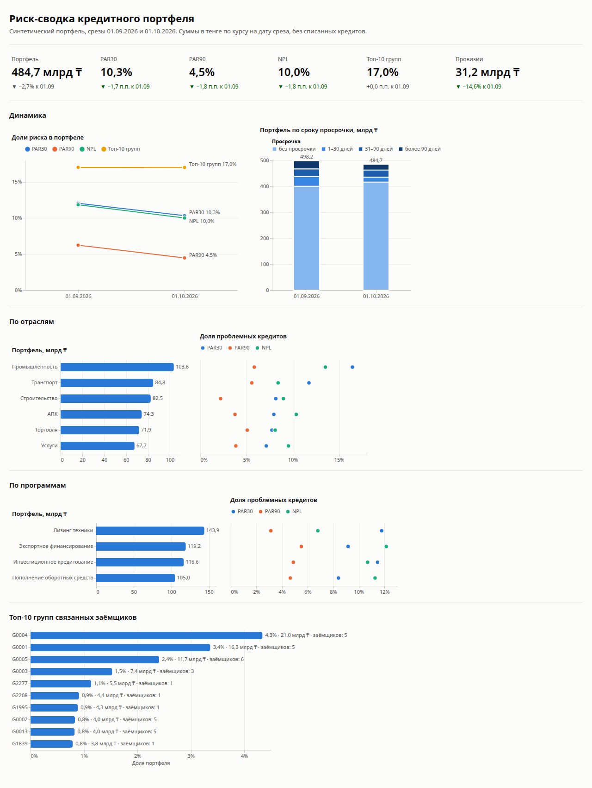

# Риск-сводка кредитного портфеля

Риск-сводка по синтетическому кредитному портфелю на двух срезах, 01.09.2026 и 01.10.2026:
витрины в PostgreSQL, семантическая модель в YAML, дашборд на Vega-Lite. Каждая цифра дашборда
пересчитана второй, независимой реализацией на Python и сверена с витринами.



## Быстрый старт

Нужны Docker, Python 3 и make. Для `make screenshot` — ещё Google Chrome.

```bash
make check   # Postgres 16 в Docker → загрузка CSV → витрины → проверки → выгрузка → сверка
make serve   # дашборд на http://127.0.0.1:8765/
```

Страница грузит спеки и данные через `fetch`, поэтому из `file://` не откроется — только через
`make serve` или любой статический хостинг. Остальные цели — в [AGENTS.md](AGENTS.md#команды).

## Итоговые цифры

Суммы — в тенге по курсу на дату среза (478,35 и 482,10 ₸ за доллар), без списанных кредитов.

| Показатель | 01.09.2026 | 01.10.2026 | Изменение |
| ---------- | ---------: | ---------: | --------: |
| Портфель, млрд ₸ | 498,2 | 484,7 | −2,7% |
| PAR30 | 12,05% | 10,33% | −1,7 п.п. |
| PAR90 | 6,24% | 4,46% | −1,8 п.п. |
| NPL | 11,85% | 10,01% | −1,8 п.п. |
| Провизии, млрд ₸ | 36,51 | 31,17 | −14,6% |
| Топ-10 групп | 17,04% | 17,02% | 0,0 п.п. |
| Кредитов в портфеле | 1 975 | 1 992 | +17 |

Из сырых данных в каждом срезе отброшено 30 полных дублей; списанных исключено 25 на 01.09 и 8 на
01.10. Всё это видно в витрине `reporting.v_data_quality`.

## Три вывода для риск-комитета

1. **Снижение NPL на 1,8 п.п. не подтверждено.** Его целиком дают 53 кредита на 14,9 млрд ₸,
   которые за месяц перешли из просрочки более 90 дней сразу в 0 дней, без реструктуризации.
   Если погашение не подтвердится платежами, NPL на 01.10 — 13,1% (рост на 1,2 п.п.), PAR90 —
   7,5%, а провизии недооценены на 7,3 млрд ₸. До отчёта об улучшении — сверить эти погашения.
2. **В промышленности растёт ранняя просрочка.** PAR30 отрасли вырос с 8,5% до 16,5%, а просрочка
   90+ почти не изменилась (6,6% → 5,8%): доля кредитов с просрочкой 31–90 дней выросла с 1,9% до
   10,7% портфеля отрасли. Это крупнейшая отрасль (103,6 млрд ₸) с самым высоким NPL (13,5%), и эти
   кредиты — кандидаты в NPL следующих срезов. Нужен разбор крупнейших заёмщиков отрасли.
3. **Выгрузку источника нужно исправить до следующего отчёта.** 23 кредита на 5,7 млрд ₸,
   списанные на 01.09, на 01.10 снова на балансе, у 10 из них просрочка 0 дней. 379 кредитов на
   84,4 млрд ₸ (17,4% портфеля) с истёкшим сроком погашения числятся без просрочки. В каждом срезе
   по 30 строк-дублей. Концентрация при этом стабильна: топ-10 групп — 17,0%, крупнейшая группа —
   4,3% портфеля.

## Как проверены цифры

1. **Профиль сырых данных до витрин:** дубли, пропуски, валюты, граничные значения просрочки,
   смена флагов одного кредита между срезами. Аномалии из выводов 1 и 3 найдены сверкой срезов
   между собой.
2. **Инварианты в SQL** — `sql/90_checks.sql`. Любая непройденная проверка останавливает загрузку:
   `unique_loan_per_date`, `single_fx_rate_per_day`, `fx_rate_on_report_date`,
   `segments_sum_to_total`, `metric_bounds`.
3. **Независимый пересчёт** — `scripts/verify.py`: те же определения на Python по исходным CSV,
   без SQL. 192 сверки с выгрузкой дашборда; хоть одно расхождение — код возврата 1.
4. **Семантический слой против базы** — `scripts/check_semantic.py`: каждая колонка из YAML
   существует в своей витрине.
5. **Идемпотентность** — `make check` прогоняет загрузку дважды подряд.

## Как толкуются определения

- **Дубли.** Полностью одинаковые строки схлопываются. Если две строки одного кредита на одну дату
  различаются, загрузка останавливается (`unique_loan_per_date`), а не выбирает одну молча.
- **Курс** — строго на дату среза, без подстановки соседнего дня. Нет курса — остановка
  (`fx_rate_on_report_date`).
- **Списанные** исключаются из портфеля и из знаменателя всех долей — по флагу на дату среза.
- **PAR30 и PAR90** — просрочка строго больше 30 и 90 дней. Кредиты ровно с 30 и 90 днями в них не
  входят: на 01.09 таких 4 (90 дней), на 01.10 — 2 (30 дней).
- **NPL** — просрочка больше 90 дней или реструктуризация. Реструктуризированный кредит идёт под
  50% провизий даже без просрочки: NPL важнее корзины.
- **Провизии 1%** начисляются и на кредиты без просрочки.
- **Концентрация** — по `group_id`, а не по заёмщику: в 38 группах больше одного заёмщика.

## Архитектура

```
data/          исходные CSV из задания
sql/           00_raw → 01_load → 10_reporting → 90_checks; порядок файлов = порядок запуска
semantic/      YAML-модели поверх витрин: portfolio (аддитивные суммы), risk_summary (доли)
dashboard/     index.html и specs/*.vl.json; data/*.json — выгрузка витрин
scripts/       export.sh (витрины → JSON), verify.py (пересчёт), check_semantic.py
docs/          скриншот дашборда, ADR
```

Сырой слой хранит CSV как есть, в `text`; типы и правила появляются в витринах `reporting.v_*`.
Дашборд статичный: читает JSON-выгрузку витрин и обходится без бэкенда.

Ключевые решения — в [docs/adr/](docs/adr/).

## Проверки

```bash
make check
```

## Что дальше

Конвенции — [AGENTS.md](AGENTS.md).
